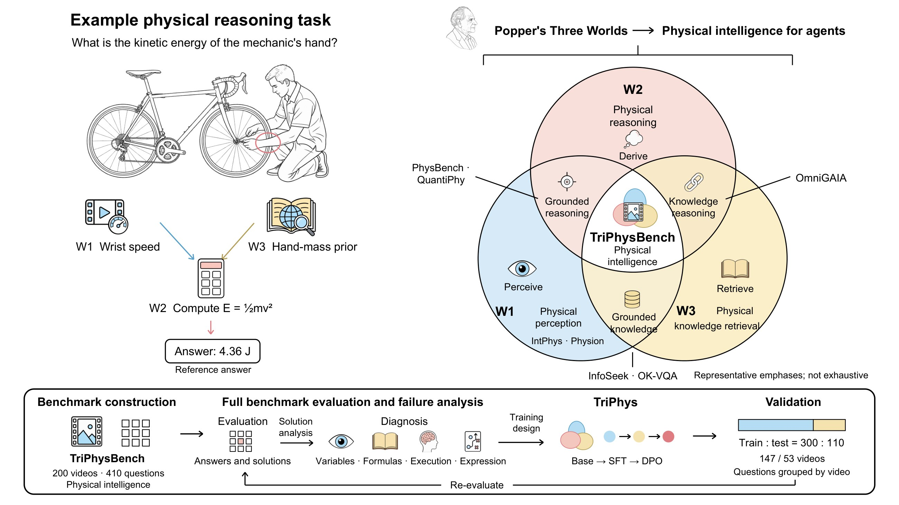
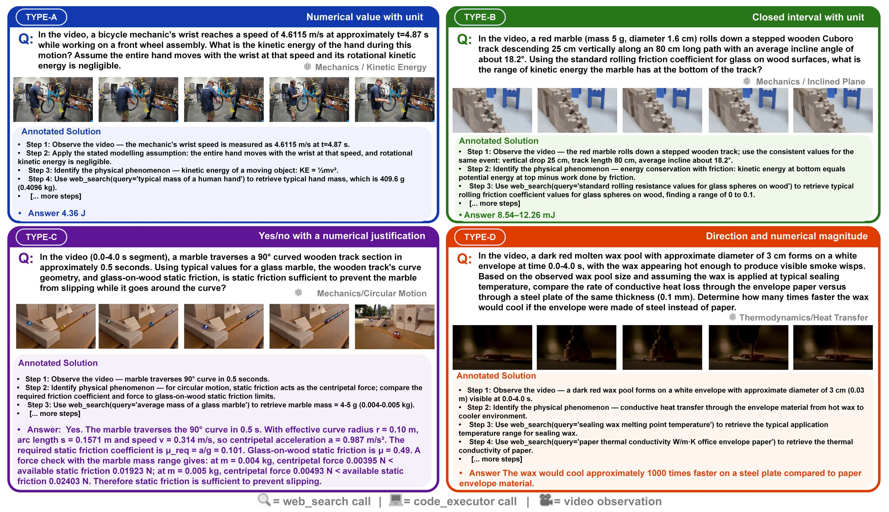
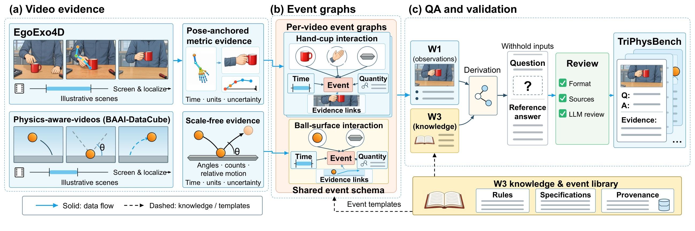
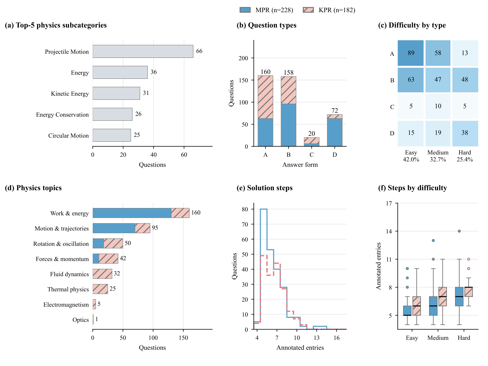
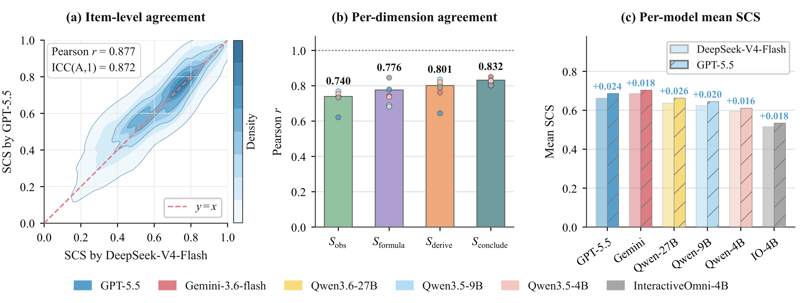
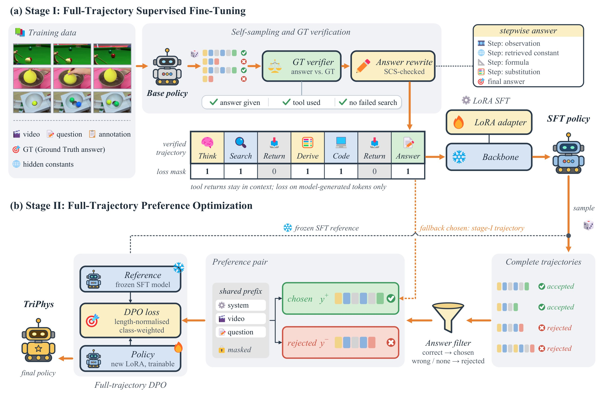

<p align="center">
  
</p>

<p align="center">
  <a href="https://yangch0429.github.io/TriPhys/"></a>
  <a href="data/"></a>
  <a href="#-leaderboard"></a>
  <a href="training/"></a>
  <a href="LICENSE"></a>
  <a href="DATA_LICENSE"></a>
</p>

<p align="center">
  <b>Zhongxiang Sun</b><sup>1</sup>, <b>Chenghao Yang</b><sup>2</sup>, <b>Haojie Ding</b><sup>3</sup>, <b>Boheng Zhang</b><sup>3</sup>, <b>Fan Yang</b><sup>3</sup>, <b>Qingsong Wen</b><sup>4</sup>, <b>Kun Wang</b><sup>5</sup>
  <br>
  <sup>1</sup>Renmin University of China &nbsp; <sup>2</sup>Zhongnan University of Economics and Law &nbsp; <sup>3</sup>Kuaishou Technology &nbsp; <sup>4</sup>Squirrel AI Learning &nbsp; <sup>5</sup>Huazhong University of Science and Technology
</p>

---

## 📖 Overview

Embodied agents need **physical intelligence**: they must perceive a physical scene, retrieve the physical knowledge it calls for, and reason quantitatively about it, all at once. Inspired by Popper's *Three Worlds*, **TriPhysBench** brings these three capabilities into one evaluation setting:

| | World | Capability | In a TriPhysBench question |
|:-:|:--|:--|:--|
| 🔵 | **W1** physical world | Physical perception | recover speeds, angles, counts and timings from the video |
| 🟡 | **W3** objective knowledge | Physical knowledge retrieval | search for masses, dimensions and material constants that match the observed object |
| 🔴 | **W2** mental activity | Physical reasoning | choose an applicable relation, derive and compute the answer with units |

<p align="center">
  
</p>

The benchmark has **410 questions from 200 real-world videos**, organized into two complementary subtasks:

- **MPR** (*Measurement-grounded Physical Reasoning*): 228 questions on 90 EgoExo4D recordings of skilled activities such as bicycle repair and sports. The solver must recover the withheld observations from the video.
- **KPR** (*Knowledge-grounded Physical Reasoning*): 182 questions on 110 recordings from BAAI-DataCube Physics-aware-videos (collisions, oscillations, fluids, deformation, heat). Observations are stated, and the solver must retrieve and apply external physical specifications.

Every question takes one of **four answer forms**: point estimation, interval estimation, physical judgment and scenario comparison. Difficulty (Easy / Medium / Hard) is set by how much information is withheld.

We also release **TriPhys**, a framework that learns a unified tool-integrated policy for perception, retrieval and reasoning. It uses full-trajectory SFT on verified self-sampled trajectories, followed by full-trajectory DPO.

## ✨ Highlights

- 🎯 **Hard for every model.** The best of six VLMs, Gemini-3.6-Flash, reaches only **50.38%** answer accuracy on the full benchmark.
- 🧩 **Answers and solutions are both scored.** ACC scores the final answer. SCS is an LLM-judged solution score over four components: variables, formula, derivation and conclusion. The SCS judge agrees with a judge from another model family (Pearson 0.877, ICC 0.872, identical model ranking).
- 🔍 **Failure diagnosis.** Variable identification fails in **56–92%** of solutions across models and subtasks. This makes the acquisition of inputs a central training target.
- 🚀 **TriPhys works across scales.** On 110 held-out questions it improves answer accuracy by **+16.4% to +17.7%** (relative) on all three Qwen backbones. **TriPhys-27B reaches 58.18%**, above GPT-5.5 (51.14%).

## 🧪 Benchmark

<p align="center">
  
  <br><sub>Four answer forms. Type A is an MPR case (EgoExo4D); Types B–D are KPR cases (Physics-aware-videos).</sub>
</p>

| Statistic | MPR | KPR | Total |
|:--|--:|--:|--:|
| Videos | 90 | 110 | 200 |
| Questions | 228 | 182 | 410 |
| Physics subcategories | 32 | 70 | 94 |
| Easy / Medium / Hard | 82 / 77 / 69 | 90 / 57 / 35 | 172 / 134 / 104 |
| Train videos / questions | 66 / 167 | 81 / 133 | 147 / 300 |
| Test videos / questions | 24 / 61 | 29 / 49 | 53 / 110 |

<details>
<summary><b>Construction pipeline and dataset statistics</b></summary>
<br>
<p align="center"></p>

Video evidence is localized and measured. MPR uses EgoExo4D 3D body pose; KPR uses scale-free estimates. The evidence is organized into physical event graphs. Questions are then generated by withholding observations or specifications, and every question is checked by LLM review and rule-based checks.

<p align="center"></p>
</details>

## 🏆 Leaderboard

### Full benchmark (410 questions, zero-shot)

<table>
<thead>
<tr><th rowspan="2" align="left">Model</th><th colspan="5">MPR</th><th colspan="5">KPR</th><th colspan="3">Overall</th></tr>
<tr><th>ACC</th><th>S<sub>obs</sub></th><th>S<sub>formula</sub></th><th>S<sub>derive</sub></th><th>OGS</th><th>ACC</th><th>S<sub>obs</sub></th><th>S<sub>formula</sub></th><th>S<sub>derive</sub></th><th>OGS</th><th>ACC</th><th>SCS</th><th>OGS</th></tr>
</thead>
<tbody>
<tr><td colspan="14"><i>Closed-source models</i></td></tr>
<tr><td> GPT-5.5</td><td><b>43.16</b></td><td>42.00</td><td><b>92.87</b></td><td>61.62</td><td>49.02</td><td>45.97</td><td>53.98</td><td>91.35</td><td>71.43</td><td>53.41</td><td>44.41</td><td>66.27</td><td>50.97</td></tr>
<tr><td> Gemini-3.6-Flash</td><td>42.67</td><td><b>48.68</b></td><td>90.02</td><td><b>63.27</b></td><td><b>49.04</b></td><td><b>60.04</b></td><td><b>59.34</b></td><td><b>92.58</b></td><td><b>74.86</b></td><td><b>64.39</b></td><td><b>50.38</b></td><td><b>68.62</b></td><td><b>55.85</b></td></tr>
<tr><td colspan="14"><i>Open-weight models</i></td></tr>
<tr><td> InteractiveOmni-4B</td><td>36.50</td><td>35.31</td><td>81.69</td><td>49.56</td><td>40.97</td><td>27.70</td><td>42.72</td><td>71.15</td><td>51.65</td><td>34.96</td><td>32.59</td><td>51.63</td><td>38.30</td></tr>
<tr><td> Qwen3.5-4B</td><td>37.39</td><td>38.49</td><td>82.46</td><td>50.55</td><td>42.14</td><td>41.51</td><td>58.52</td><td>88.46</td><td>66.48</td><td>49.25</td><td>39.22</td><td>59.47</td><td>45.30</td></tr>
<tr><td> Qwen3.5-9B</td><td>39.24</td><td>40.35</td><td>87.50</td><td>54.50</td><td>44.59</td><td>45.36</td><td>58.93</td><td>89.70</td><td>69.37</td><td>52.54</td><td>41.96</td><td>62.49</td><td>48.12</td></tr>
<tr><td> Qwen3.6-27B</td><td>41.44</td><td>43.53</td><td>89.04</td><td>55.70</td><td>46.57</td><td>46.72</td><td>58.52</td><td>92.03</td><td>70.05</td><td>53.73</td><td>43.78</td><td>63.66</td><td>49.75</td></tr>
</tbody>
</table>

### Held-out test set (110 questions from videos excluded from training)

| Model | MPR ACC | KPR ACC | ACC | SCS | OGS |
|:--|:-:|:-:|:-:|:-:|:-:|
| *Closed-source models* | | | | | |
|  GPT-5.5 | 51.71 | 50.43 | 51.14 | 69.07 | 56.52 |
|  Gemini-3.6-Flash | **53.28** | 66.34 | **59.10** | 70.42 | **62.50** |
| *Open-weight models* | | | | | |
|  Qwen3.5-4B | 44.12 | 49.32 | 46.44 | 62.51 | 51.26 |
| &nbsp;&nbsp;🟢 **TriPhys-4B** | 51.79 <sub>+17.4</sub> | 57.29 <sub>+16.2</sub> | 54.24 <sub>+16.8</sub> | 68.28 <sub>+9.2</sub> | 58.45 <sub>+14.0</sub> |
|  Qwen3.5-9B | 41.17 | 54.05 | 46.90 | 66.18 | 52.68 |
| &nbsp;&nbsp;🟢 **TriPhys-9B** | 48.87 <sub>+18.7</sub> | 61.69 <sub>+14.1</sub> | 54.58 <sub>+16.4</sub> | 70.16 <sub>+6.0</sub> | 59.25 <sub>+12.5</sub> |
|  Qwen3.6-27B | 44.71 | 55.25 | 49.41 | 67.84 | 54.94 |
| &nbsp;&nbsp;🟢 **TriPhys-27B** | 51.54 <sub>+15.3</sub> | **66.46** <sub>+20.3</sub> | 58.18 <sub>+17.7</sub> | **71.56** <sub>+5.5</sub> | 62.19 <sub>+13.2</sub> |

<sub>All scores ×100; bold marks the best score in each column. ACC: answer correctness with partial credit. S<sub>obs</sub>, S<sub>formula</sub>, S<sub>derive</sub>: solution-score components for variable identification, relation selection and numerical derivation. SCS = 0.25 S<sub>obs</sub> + 0.25 S<sub>formula</sub> + 0.30 S<sub>derive</sub> + 0.20 S<sub>conclude</sub>, judged by DeepSeek-V4-Flash. OGS = 0.7 ACC + 0.3 SCS. Subscripts in the test-set table give the relative gain (%) over each backbone.</sub>

<details>
<summary><b>Is the SCS judge reliable?</b></summary>
<br>
<p align="center"></p>

GPT-5.5, from a different model family, re-scored all 2,460 question–model pairs. Its SCS agrees closely with DeepSeek-V4-Flash: Pearson r = 0.877, ICC = 0.872, and an identical model ranking.
</details>

## 🛠️ TriPhys

<p align="center">
  
</p>

- **Stage I: full-trajectory SFT.** The backbone samples tool-integrated trajectories on the 300 training questions without seeing the reference. Trajectories that pass answer verification (ACC ≥ 0.9, an answer in the last turn, at least one tool call, no failed retrieval) are kept; questions that no sample solves are filled with tool-using teacher trajectories that never see the reference. Their final answer block is rewritten into a stepwise chain built only from values already in the trajectory. Tool returns are masked from the loss.
- **Stage II: full-trajectory DPO.** The SFT policy produces on-policy rollouts, which are paired into chosen and rejected trajectories; the shared prefix is masked. A new LoRA adapter is trained on the merged SFT model, with the SFT model as the frozen reference.


## 📂 Repository structure

```
TriPhys/
├── data/            # the benchmark: MPR / KPR, all + train + test splits, video lists, physics event library
├── triphys/         # shared library: prompts, tools (web_search / code_executor), parser, ACC / SCS metrics
├── evaluation/      # zero-shot evaluation (Qwen, InteractiveOmni, GPT-5.5 / Gemini), scoring, aggregation
├── training/        # TriPhys Stage I (SFT) and Stage II (DPO): data construction, training, evaluation
│   ├── evallib/         # evaluation library used by training-time sampling and evaluation (ACC / SCS)
│   ├── n1/              # tool-loop evaluation and sampling of trained models, LoRA SFT
│   ├── scripts/         # Stage I data (p1_*), Stage II rollouts, pairs and DPO (p2_*), pipeline scripts
│   ├── teacher_pilot/   # tool-using Gemini teacher that never sees the reference answer
│   └── run_4b.sh        # the full Qwen3.5-4B pipeline, step by step
└── docs/            # project page (GitHub Pages)
```

## 🚀 Quick start

### 1. Install

```bash
git clone https://github.com/yangch0429/TriPhys.git && cd TriPhys
conda create -n triphys python=3.10 -y && conda activate triphys
# install PyTorch for your CUDA version first (https://pytorch.org)
pip install -r requirements.txt
cp .env.example .env    # fill in video roots and API keys, then: set -a; source .env; set +a
```

### 2. Get the videos

The videos are not redistributed. The lists of required recordings are in [`data/videos_mpr.txt`](data/videos_mpr.txt) and [`data/videos_kpr.txt`](data/videos_kpr.txt).

- **MPR (EgoExo4D).** Accept the [EgoExo4D license](https://ego-exo4d-data.org/) and download the listed takes. Use the frame-aligned video of each take's official `best_exo` camera, stored as `$EGOEXO_ROOT/<take_uid>/best_exo.mp4`.
- **KPR (Physics-aware-videos).** Download the listed files from [BAAI-DataCube/Physics-aware-videos](https://huggingface.co/datasets/BAAI-DataCube/Physics-aware-videos) into `$BAAI_ROOT/<folder_id>/<video_id>.mp4`.

### 3. Evaluate a model

```bash
# open-weight Qwen models (shard over GPUs with --shard_id i --n_shards n)
python evaluation/eval_qwen.py --base_model Qwen/Qwen3.5-4B --out results/qwen35_4b.jsonl
# InteractiveOmni-4B
python evaluation/eval_interactiveomni.py --model sensenova/InteractiveOmni-4B --out results/interactiveomni4b.jsonl
# GPT-5.5 / Gemini-3.6-Flash through any OpenAI-compatible endpoint
python evaluation/eval_api.py --model gemini --out results/gemini36flash.jsonl

# score (ACC rules + LLM fallback, SCS judge) and report MPR / KPR / Overall
python evaluation/rescore.py results/qwen35_4b.jsonl
python evaluation/aggregate.py results/qwen35_4b*.jsonl --out results/qwen35_4b_summary.json
```

Every model gets the same system prompt and solves each question in a native tool loop with `web_search` (Serper) and `code_executor`, for at most 6 turns.

### 4. Train TriPhys

```bash
export TRIPHYS_WORK=/path/to/work && bash training/setup_work.sh
bash training/run_4b.sh        # Stage I and Stage II for Qwen3.5-4B (8 × 80 GB GPUs); runs in $TRIPHYS_WORK
```

`setup_work.sh` creates the work directory (`scripts` → `training/scripts`, `fc/training` → `training`, the released split under `data/f10/`). Base models default to the Hugging Face ids (`BASE_MODEL=Qwen/Qwen3.5-4B`, `B9=Qwen/Qwen3.5-9B`, `B27=Qwen/Qwen3.6-27B`); a local directory can be set instead. "A" / "B" in the code mean MPR / KPR.

**Stage I: full-trajectory SFT.**

1. `p1_selfsample.sh`: the backbone samples the 300 training questions in the tool loop (T 0.7, 4 samples per question, `n1/eval_n1_sample.py`).
2. `p1_rft_build.py`, `p1_rft_balance.py`: answer verification keeps trajectories with ACC ≥ 0.9, an `<answer>` block, at least one tool call and no failed retrieval, balanced over MPR / KPR and answer forms.
3. `p1_rft_chain.sh`, `p1_selfsample2.sh`: LoRA SFT on the verified set (`n1/train_sft_n1.py`: r 32, 3 epochs, lr 1e-4), then a second round of sampling with the resulting model.
4. `teacher_pilot/teacher_full.py`, `p1_gemini_conv.py`: tool-using Gemini trajectories for questions that no sample solved; the teacher never sees the reference answer.
5. `p1_rewrite.py`: the final `<answer>` block is rewritten into a stepwise chain that uses only values already in the trajectory; a rewrite is kept only if its SCS is ≥ max(0.75, the original SCS).
6. `p1_commit.py`, `p1_commit_build.py`: for trajectories that stall without an answer, the model continues from the first two tool rounds; continuations are kept only if they pass verification.
7. The verified, rewritten trajectories form the Stage I set; LoRA SFT on it gives the Stage I model. Tool returns are masked from the loss.

**Stage II: full-trajectory DPO.**

8. `p2_worker.sh` / `p2_online.py`: on-policy rollouts of the Stage I model on the training questions (T 0.7).
9. `p2_pairs_full.py`: at most two pairs per question. Chosen: a correct rollout of the Stage I model (ACC ≥ 0.9, SCS ≥ 0.75), otherwise a Stage I trajectory of the same question. Rejected: a wrong (ACC < 0.5) or unanswered rollout.
10. `train_dpo_p2.py`: the Stage I model is merged and serves as both the initialization of a new LoRA adapter and the frozen reference; length-normalized DPO from the first token where chosen and rejected differ (β 0.1, lr 5e-6, 2 epochs).
11. `p2_reeval_n1.sh`: evaluation on the 110 test questions with `n1/eval_n1.py` (sharded over GPUs, then merged).

Qwen3.5-9B and Qwen3.6-27B are trained on the same Stage I trajectories and DPO pairs with `scripts/p9_chain.sh` and `scripts/p27_chain.sh`. Training data are model samples scored by API judges and web search results change over time, so a rerun produces data of the same kind rather than identical rows.

## 🗂️ Data format

`data/mpr_{all,train,test}.json` and `data/kpr_{train,test}.json` are lists of videos, each with its `qa_pairs`. `data/kpr_all.json` stores the flat question list under `qa_pairs`. `data/_shared_physics_library.json` is the physics event library used to build the event graphs: 29 event categories, each with its visual triggers, latent properties, rules and relevant formulas.

```jsonc
{
  "take_uid": "0ccfd492-...",               // MPR; KPR uses "folder_id" + "video_id"
  "qa_pairs": [{
    "question": "In the video, an athlete's maximum wrist speed ... ",
    "question_type": "TYPE_A",              // A point | B interval | C judgment | D comparison
    "difficulty": "easy",                   // easy | medium | hard
    "answer": "4.55 J",
    "answer_range": null,                   // [low, high] for TYPE_B
    "annotated_solution": ["Step 1: ...", "..."],
    "sources": [{"type": "video_observation", "time_point": "10.6s", "key_information": "..."},
                {"type": "web_search", "url": "https://...", "key_information": "..."}],
    "hidden_cv_chosen": [],                 // video measurements withheld from the question (MPR)
    "physics_category": "Mechanics/Kinetic_Energy"
  }]
}
```

## 📝 Citation

```bibtex
@article{sun2026triphysbench,
  title   = {TriPhysBench: Evaluating Physical Intelligence for Embodied Agents},
  author  = {Sun, Zhongxiang and Yang, Chenghao and Ding, Haojie and Zhang, Boheng and Yang, Fan and Wen, Qingsong and Wang, Kun},
  year    = {2026}
}
```

## 🙏 Acknowledgements

TriPhysBench builds on [EgoExo4D](https://ego-exo4d-data.org/) and [BAAI-DataCube Physics-aware-videos](https://huggingface.co/datasets/BAAI-DataCube/Physics-aware-videos). We thank their authors.

## ⚖️ License

The code is released under the [MIT License](LICENSE). The question annotations in `data/` are released under [CC BY-NC 4.0](DATA_LICENSE). The videos remain under the licenses of EgoExo4D and Physics-aware-videos.
